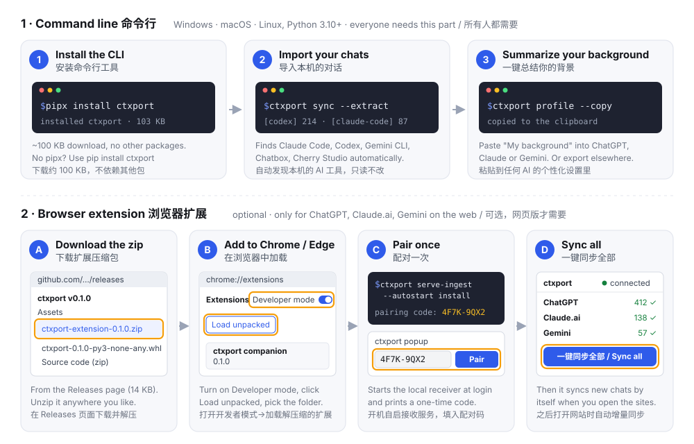

# ctxport

**Local-first migration of AI chat history and memory** · 本地优先的 AI 对话与记忆迁移工具

English · [简体中文](https://github.com/Memoryport/ctxport/blob/main/README.zh-CN.md) · MIT · Python ≥ 3.10 · zero dependencies in the core

---

## Why

Many of us switch between ChatGPT, Codex, Claude.ai, Claude Code, Gemini CLI, Gemini on the web, Google Antigravity, Cherry Studio and Chatbox. Each tool keeps its context and memory to itself. Asking the old assistant to "summarize what you know about me" gives you a lossy, out-of-date summary.

ctxport doesn't ask a model to remember. It **parses each platform's raw data** directly:

```
official exports / local session files / local databases
        │  (read-only; databases are copied to a temp folder first)
        ▼
  one common model (Conversation / Message / MemoryItem)
        ▼
  local SQLite  ~/.ctxport/ctxport.db  (FTS5 trigram full-text search, works for CJK without word splitting)
        ▼
  memory extraction (rules / optional local LLM) → your review
        ▼
  each target written in the form it accepts   +   an MCP server so any client can search your whole history
```

## Supported platforms

| Platform | Imports from | Exports to | Notes |
|---|---|---|---|
| ChatGPT | **Browser extension, one click or automatic**; or the official export zip (branch trees, custom instructions, memory) | `chatgpt-memory.txt` (paste into custom instructions or a chat) | |
| Claude.ai | **Browser extension, one click or automatic**; or the official export zip (conversations, projects, memories) | `claude-memory-import.txt` → claude.ai/import-memory | |
| Claude Code | `~/.claude/projects/**.jsonl`, subagents, CLAUDE.md, auto memory | managed block in `~/.claude/CLAUDE.md` (or `--project`) | auto-detected |
| Codex (CLI / IDE / app) | rollout JSONL, **`thread_history_*.sqlite`**, AGENTS.md, memories/ | managed block in `~/.codex/AGENTS.md` | auto-detected; newer versions keep many threads only in SQLite |
| Gemini CLI | `~/.gemini/tmp/*/chats/session-*.json(l)`, checkpoints, GEMINI.md | managed block in `~/.gemini/GEMINI.md` | auto-detected |
| Gemini web / app | **Browser extension** (reads the pages in a background tab); or Google Takeout `MyActivity.json` | `gemini-saved-info.txt` | experimental |
| Google Antigravity | `conversations/*.pb` (generic protobuf decoding), brain/, knowledge/, rules | `~/.gemini/AGENTS.md` (≤ 11,000 characters) | experimental |
| Cherry Studio | **Reads its local IndexedDB automatically** (1.x), 2.x `cherrystudio.sqlite`, `agents.db`, backup zip | `cherry-assistant-prompt.md` | auto-detected; never writes its database |
| Chatbox | **Reads its local IndexedDB automatically**; or backup V1 json / V2 zip / V3 zip | `chatbox-import-v1.json` + `chatbox-system-prompt.md` | auto-detected |
| Generic | `openai-messages` (DeepSeek, Kimi, LM Studio…), `ctxport-jsonl` | `markdown` / `ctxport-jsonl` / `json` / `csv` / `memory-md` | |

"Experimental" means the format couldn't yet be checked against real samples. Format details, and the differences observed on real machines, are in [docs/formats.md](https://github.com/Memoryport/ctxport/blob/main/docs/formats.md).

## Install

<p align="center"></p>

**1. Command line** (everyone, Python ≥ 3.10). The package is about 100 KB and has no dependencies.

```bash
pipx install ctxport            # or: pip install ctxport   ·   uv tool install ctxport
ctxport sync --extract          # import what's on this computer
ctxport profile --copy          # your background, ready to paste into any AI
```

Need the MCP server too? `pipx install "ctxport[mcp]"` (this is the only extra that adds a dependency).
Before the first PyPI release, use `pipx install git+https://github.com/Memoryport/ctxport` instead.

**2. Browser extension** (optional: only for ChatGPT, Claude.ai and Gemini on the web, which keep your chats on
their servers).

1. Download `ctxport-extension-<version>.zip` (about 14 KB) from the
   [latest release](https://github.com/Memoryport/ctxport/releases/latest) and unzip it.
2. Open `chrome://extensions` (or `edge://extensions`), turn on **Developer mode**, click **Load unpacked** and
   pick the unzipped `ctxport-extension` folder.
3. Run `ctxport serve-ingest --autostart install` once. It starts the local receiver at login and prints a pairing
   code; type it into the extension's popup and click **Pair**.
4. Click **Sync all**. After that, new chats sync by themselves when you open those sites.

No release yet, or want the latest code? `git clone --depth 1 https://github.com/Memoryport/ctxport` and load its
`extension/` folder in step 2.

## No manual exports

| Source | How ctxport gets it |
|---|---|
| Claude Code, Codex, Gemini CLI, Antigravity | Reads the local session files and databases: `ctxport sync` |
| Chatbox, Cherry Studio (1.x) | Reads the app's own Chromium IndexedDB in pure Python (LevelDB + snappy + V8 deserialization), read-only, from a temp copy: `ctxport sync` |
| ChatGPT, Claude.ai, Gemini web | The data only lives on their servers, so install the [ctxport browser extension](https://github.com/Memoryport/ctxport/blob/main/extension/README.md) once. It syncs through the tab you're already logged into, then syncs new chats automatically when you open the site. Data is only sent to `127.0.0.1` on your machine. |

```bash
ctxport serve-ingest --autostart install   # once: start the local receiver at login (for the extension)
ctxport serve-ingest --pair                # once: print a pairing code, type it into the extension popup
ctxport sync --extract                     # import local sources + what the extension sent, incrementally
```

With many ChatGPT conversations, syncing one by one is slow (ChatGPT rate-limits reads). Request the official
export with one click in the extension popup or `ctxport app`; a downloaded export zip left in the Downloads folder is
imported by `ctxport sync`. Once you have it, `ctxport forget-web chatgpt` (or the delete button in `ctxport app`)
deletes what the extension collected for that site and turns its web sync off, so the extension doesn't read it again;
conversations from official exports and your reviewed memories are kept. `ctxport web-sync chatgpt on` turns it back on.

ctxport never decrypts browser cookies or reads saved passwords. Web data can only be read by the extension in your browser, on pages where you're logged in.

## Quick start

```bash
ctxport platforms                    # supported platforms, what's detected here, how to get each export
ctxport sync --extract               # import every local source incrementally and extract memory candidates
ctxport import chatgpt ~/Downloads/chatgpt-export.zip
ctxport stats                        # conversations, messages, time range and models per platform
ctxport stats --size                 # disk usage; `ctxport compact` shrinks the database
ctxport memories edit                # writes a ctxport-memories.md checklist; edit it, then run again to apply
ctxport profile --copy               # one-page summary of your background, ready to paste into any AI
ctxport export claude-code           # preview into ./ctxport-out/
ctxport export claude-code --apply   # write the ctxport block in ~/.claude/CLAUDE.md
ctxport export markdown              # full archive: one .md per conversation + INDEX.md + MEMORY.md
ctxport search "vector database"     # FTS5 for 3+ characters, falls back to LIKE for shorter terms
```

By default ctxport **only writes previews** to `./ctxport-out/`. Only `--apply` writes to the real locations, and then it only changes the block between `<!-- ctxport:begin … -->` and `<!-- ctxport:end -->`. The original file is backed up as `*.ctxport.bak` before the first write.

## One-click import into other AIs: `ctxport app`

```bash
ctxport app
```

Opens a page served only on this computer (`127.0.0.1`, a fresh random access token per launch). On macOS,
`ctxport app --launcher ~/Desktop` once puts a double-clickable ctxport.app on the desktop: it starts the app in the
background and opens the page, or reopens the page when the app is already running.

* **Memories** — review candidates (keep / drop / rewrite, in bulk too); only accepted memories are imported.
* **Coding agents** — write into Claude Code, Codex, Gemini CLI and Antigravity instruction files (managed block only,
  original backed up once as `*.ctxport.bak`); Cursor gets a project rule `.cursor/rules/ctxport.mdc` or text for User Rules.
* **Connect MCP** — register ctxport in Claude Desktop, Claude Code, Codex, Cursor, Gemini CLI and Antigravity; only the
  `ctxport` entry is added or removed, unreadable config files are never overwritten.
* **Web AI memory** — with the [browser extension](extension/README.md): ChatGPT custom instructions ("about you"; your
  own text is kept, only the part after `[ctxport]` is replaced, within 1,500 characters), Claude.ai memory import and
  Gemini saved info (form filling, experimental). Without the extension: copy the text and open the page.
* **Desktop chat apps** — Chatbox import file and Cherry Studio assistant prompt, revealed in the file manager.

The text written into web accounts is always fetched by the extension from your local ctxport (accepted, masked
memories only); a web page can never choose what gets written.

### Full profile: `ctxport distill` (no API key)

Use an AI you already have; ctxport prepares the material, merges the results and checks that every fact is in
the final profile:

```bash
ctxport distill --agent claude-code      # your own Claude Code, batch by batch (or --agent codex); resumable
ctxport distill --agent folder           # task folder for any agent: "follow TASK.md"
ctxport distill --manual ~/ctxport-web   # prompts to paste into ChatGPT / Claude on the web
ctxport export claude-code --distilled --apply
```

In `ctxport app` the same flow is step 2 of a guided page. By default it asks your agent directly ("省 token"):
conversations are shortened first (code reduced to what it is, long pastes to their start and end) and several are
sent per question, about a tenth of the tokens of letting the agent read files one by one (still available). pick Claude Code or Codex (also the copy bundled with the ChatGPT desktop app), the model (e.g. Haiku, Sonnet,
Opus or any model name) and the reasoning effort, and how many recent conversations to process; it shows how many
conversations, batches and tokens that is before you start (after the first batch, from the usage the agent
reported), a progress bar while it runs, and a Stop button (a later run
resumes). (Advanced: `--api` uses an OpenAI-compatible endpoint configured with `ctxport llm set`.)

## Summarize your background in one command

Starting fresh with a new assistant? `ctxport profile` turns your memories and recent chat topics into one short
page you can paste anywhere. Nothing leaves your machine unless you add `--llm` with a remote endpoint.

```bash
ctxport sync --extract          # once: import your local chats and pick out facts about you
ctxport memories edit           # optional but recommended: tick the facts you want to keep
ctxport profile --copy          # copy "My background" to the clipboard (or --out me.md)
ctxport profile --llm           # also add a short first-person summary written by your local Ollama
ctxport profile --max-chars 1500 --topics 0   # fits ChatGPT's custom-instructions box
```

The page has three parts: an optional *In short* paragraph, your memories grouped as *About me*, *Work*,
*Preferences*, *Projects* and *Tools*, and *Things I've been working on lately* (titles of your most recent
conversations; `--topics 0` leaves them out, `--since 90d` narrows them). Secrets are masked. If you haven't
reviewed anything yet, it falls back to the unreviewed candidates and tells you so. Paste it into ChatGPT →
Settings → Personalization → Custom instructions, claude.ai/import-memory or a Claude project, Gemini → Saved info,
or simply as the first message of a new chat.

### Filling the gaps: a 30-question background questionnaire

Extraction only finds what you happened to say. ctxport checks your memories against 30 background questions in
three stages (1 · who you are, 2 · what you work on and with, 3 · how you like to be helped) and fills what is
missing, cheapest first:

```bash
ctxport memories coverage        # which questions your memories already answer, stage by stage
ctxport extract --questions      # for each unanswered question: search YOUR messages for it, let the local LLM
                                 # answer from those excerpts only, with citations; no citation → dropped
ctxport ask                      # still missing? answer up to 5 short questions yourself (saved as accepted)
ctxport prompt > ask-chatgpt.md  # or paste this into the assistant you're leaving, save its answer, then:
ctxport memories import answer.md --platform chatgpt
```

Everything that came from a model (`--questions`, the pasted prompt) is a candidate until you tick it in
`ctxport memories edit`. The questions never ask for ID numbers, addresses, health, politics, religion or money.

## Common migrations

| Goal | Command |
|---|---|
| ChatGPT → Claude | `ctxport migrate chatgpt export.zip claude-ai`, then paste at claude.ai/import-memory |
| Codex ⇄ Claude Code | `ctxport sync`, then `ctxport export claude-code --apply` or `ctxport export codex --apply` |
| Move to Gemini / Antigravity | `ctxport export gemini-cli,antigravity --apply`; for the web app, `ctxport export gemini-web` |
| ChatGPT history into Chatbox | `ctxport import chatgpt export.zip && ctxport export chatbox --platform chatgpt --since 180d`, then Chatbox Settings → Backup → Import |
| Continue a chat in another assistant | `ctxport list` to find the id, then `ctxport handoff <id> --last 30 [--llm] --out handoff.md` |
| New computer | `ctxport export ctxport-jsonl`, then on the new one `ctxport import ctxport-jsonl ctxport.jsonl` |

## Lossless import

* Every conversation, with no count or date limit, including archived ones. Codex threads whose rollout files were cleaned up are recovered from `thread_history_*.sqlite`.
* **Main line and branches**: the main line is the one you actually saw. Regenerations, edit forks, rewinds and Chatbox thread history are kept as `branches` and marked as such in archives.
* Tool calls, tool results and reasoning are **stored** (kind `tool_call` / `tool_result` / `reasoning`) but filtered out of migrations, memory extraction and MCP search by default. `--include-tools` / `--include-reasoning` turn them on. Encrypted reasoning is only recorded as "there was reasoning"; the ciphertext isn't stored.
* Injected context (`<environment_context>`, `# AGENTS.md instructions`, `<system-reminder>`, `<command-name>`, `isMeta` …) is marked `system_prompt` and isn't counted as something you said.
* Attachments aren't copied; only file name, MIME type, size and path or resource key are kept.
* Timestamps in seconds, milliseconds, microseconds and ISO-8601 (including `Z` and 7 fractional digits) are understood. Re-importing replaces a conversation instead of duplicating it; unchanged files are skipped by an `mtime+size` signature, and `--force` re-imports anyway.
* `--keep-raw` also stores each message's raw JSON (without binaries or encrypted signatures). The database gets about 2–3× bigger.
* **Small on disk.** Long tool outputs (logs, file dumps) keep only their first and last 2 KB (`--keep-full-tools` keeps them whole), and the full-text index covers your dialogue only. On a coding-assistant sample this took the database from 274 MB to 30 MB. `ctxport stats --size` shows what takes the space, and `ctxport compact` trims databases made by older versions and gives free space back (126 MB → 29 MB on the same sample).

## How memory extraction works

1. **Explicit memory** is accepted directly: custom instructions, CLAUDE.md / AGENTS.md / GEMINI.md, memories from platform exports, Chatbox memory.
2. **Rules** (offline, the default) look only at your own messages, split them into sentences of 6–200 characters, skip questions, code and logs, and match patterns such as "I am a / my name is / I prefer / I use / from now on" (and their Chinese equivalents). Results are candidates (confidence 0.4).
3. **Rules** also catch self-descriptions that don't start the sentence the usual way ("As a teacher, …", "我平时写 Rust", "Our stack is …") and the opening of a question ("我是前端开发，怎么学 Rust？" → "我是前端开发"). Edited and regenerated branches are read too.
4. **LLM extraction** (`--llm`, optional) uses any OpenAI-compatible API; the default is a local Ollama at `http://localhost:11434/v1` with `qwen2.5:7b` (`CTXPORT_LLM_BASE_URL` / `CTXPORT_LLM_MODEL` / `CTXPORT_LLM_API_KEY`). It sends **only your messages** (secrets masked first) in chunks of about 6,000 characters. A non-localhost endpoint needs `--allow-remote`. Assistant statements you explicitly confirmed ("so your stack is Go and Postgres?" → "yes") are included, marked as confirmed. Results are candidates (confidence 0.8). Note that `handoff --llm` is different: to summarize, it sends the earlier part of the conversation from **both sides** (also masked).
5. Each conversation is extracted once per method, and again automatically when it changes. A fact that comes up again (even reworded: "I use VS Code" / "I use VSCode.") is merged into the existing memory, which counts how many conversations mentioned it and when it was first and last seen. Memories you see most often and most recently rank first, a reworded version of something you rejected stays rejected, and the review checklist marks an older fact as "maybe outdated" when a newer related one appears (for example a new editor). `ctxport memories dedupe` merges duplicates already in an older store; `ctxport memories coverage` shows what's still missing.
6. **Review**: `ctxport memories edit` writes a checklist where `[x]` keeps a memory, `[ ]` rejects it, and you can rewrite the text. Rejected memories don't come back on later imports. `memories list/add/accept/reject/rm` work too.
7. Exports contain accepted memories only (`--include-candidates` adds candidates). Every export is masked: OpenAI / Anthropic / GitHub / GitLab / Google / AWS / Slack / Stripe / Hugging Face keys, JWTs, private key blocks, `password|token|api_key = …` (also in JSON and environment variables such as `GITHUB_TOKEN=…`), `Authorization: Bearer …`, and `user:password@` in URLs. `--no-redact` turns masking off.

## MCP

```bash
pipx install "ctxport[mcp]"     # or: pip install "ctxport[mcp]"
ctxport mcp-config            # prints config for Claude Desktop / Claude Code / Codex / Gemini CLI / Antigravity / Cherry Studio / Chatbox
claude mcp add --scope user ctxport -- ctxport serve-mcp
```

Tools: `get_user_memory()`, `search_history(query, platform?, limit)`, `list_recent_conversations(platform?, limit)`, `get_conversation(conversation_id, last_n)`, and `remember(fact, category)`, which saves a *candidate* that only takes effect and gets exported after you accept it in `ctxport memories edit`. Works with mcp 1.x and 2.x, and all output is masked. If a GUI app can't find `ctxport`, use its absolute path.

## Privacy

* Local only: no network requests except the LLM extraction you turn on yourself, and no telemetry.
* Never modifies other apps' databases or session files. Databases are copied, with their `-wal`/`-shm` files, to a temp folder before reading.
* Data lives in `~/.ctxport/` (or `CTXPORT_HOME`), readable only by you (0700 / 0600).
* The browser extension pairs with `ctxport serve-ingest` through a one-time code (`ctxport serve-ingest --pair`), and every request must carry that extension's token.
* `.gitignore` already excludes `ctxport-out/`, `*.db`, `*.zip` and `ctxport-memories.md`.

## Architecture

```
src/ctxport/
  models.py  store.py  pipeline.py  extract.py  llm.py  redact.py  utils.py  cli.py  mcp_server.py  ingest.py
  chromium/  leveldb.py (log/table/snappy)  indexeddb.py (IDB keys, blobs, Local Storage)  v8.py (structured clone)
  adapters/  base.py(@register)  _render.py  _instruction.py
             chatgpt  claude_ai  claude_code  codex  gemini_cli  gemini_web  antigravity  cherry_studio  chatbox  generic
extension/   Chrome/Edge MV3 extension (the sync logic in core.js is unit-tested in Node)
```

Adding a platform means adding one adapter file (an Importer and/or Exporter subclass). N platforms need N adapters, not N×N converters. See [CONTRIBUTING.md](https://github.com/Memoryport/ctxport/blob/main/CONTRIBUTING.md).

## Known limitations

* The Chromium IndexedDB reader is an independent implementation of a subset: an unsupported V8/Blink type skips that record with a warning. Newer Chatbox messages have no timestamps, so those conversations have no time.
* The Claude desktop app's local cache only holds the conversation list (no content), so Claude.ai content comes through the browser extension.
* The browser extension uses the sites' private front-end APIs and may break when they change. Gemini works by reading the page, which is slower and more fragile.
* Antigravity's `.pb` format isn't public: generic decoding only recovers readable text, roles are `unknown`, and there were no samples to calibrate field numbers.
* Gemini Takeout doesn't separate conversations; entries are grouped by 30-minute gaps (`CTXPORT_TAKEOUT_GAP_MIN`).
* ChatGPT and Gemini web have no bulk memory import, so ctxport can only produce text to paste.
* Platform formats change without notice; a file that fails to parse is skipped with a warning.

## Tests

Importer tests for every platform and format variant, incremental sync, export targets and idempotent `--apply`, FTS/LIKE search, rule and mocked-LLM extraction, redaction, time parsing, an end-to-end MCP stdio test, and Node unit tests for the browser extension (`pytest -q`). CI runs on Ubuntu / macOS / Windows × Python 3.10 / 3.12 / 3.13.

## Disclaimer

ctxport is an independent open-source project, not affiliated with OpenAI, Anthropic, Google, Cherry Studio or Chatbox. All trademarks belong to their owners. Only migrate your own data, and follow each platform's terms.
