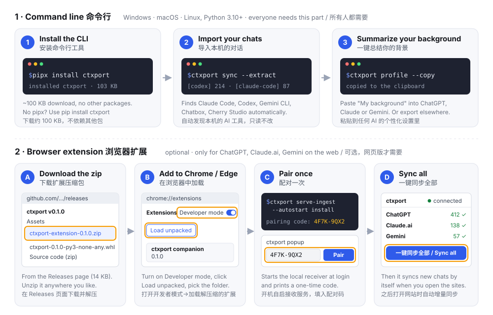

# ctxport

**本地优先的 AI 对话与记忆迁移工具** · Local-first migration of AI chat history and memory

[English](README.md) · MIT · Python ≥ 3.10 · 核心零依赖

---

## 为什么需要它

我们在 ChatGPT、Codex、Claude.ai、Claude Code、Gemini CLI、Gemini 网页版、Google Antigravity、Cherry Studio、Chatbox 之间来回切换。每个工具的上下文和记忆都是孤岛；让旧助手"总结一下你对我的了解"，得到的是有损、过时的摘要。

ctxport 不靠模型回忆，而是**直接解析各平台的原始数据**：

```
官方导出包 / 本地会话文件 / 本地数据库
        │  (只读；数据库先复制到临时目录)
        ▼
  统一中间格式 (Conversation / Message / MemoryItem)
        ▼
  本机 SQLite  ~/.ctxport/ctxport.db  (FTS5 trigram 全文检索，中文免分词)
        ▼
  记忆提取 (规则 / 可选本地 LLM) → 人工审核
        ▼
  按目标平台能接收的方式输出   +   MCP Server：任何客户端都能检索全部历史
```

## 支持矩阵

| 平台 | 导入来源 | 导出到 | 备注 |
|---|---|---|---|
| ChatGPT | **浏览器扩展一键/自动同步**；或官方导出 zip（含分支树、自定义指令、记忆） | `chatgpt-memory.txt`（粘贴到自定义指令/对话） | |
| Claude.ai | **浏览器扩展一键/自动同步**；或官方导出 zip（对话、projects、memories） | `claude-memory-import.txt` → claude.ai/import-memory | |
| Claude Code | `~/.claude/projects/**.jsonl`、子代理、CLAUDE.md、自动记忆 | `~/.claude/CLAUDE.md` 标记区块（或 `--project`） | 自动检测 |
| Codex（CLI/IDE/App） | rollout JSONL、**`thread_history_*.sqlite`**、AGENTS.md、memories/ | `~/.codex/AGENTS.md` 标记区块 | 自动检测；新版大量线程只在 SQLite 里 |
| Gemini CLI | `~/.gemini/tmp/*/chats/session-*.json(l)`、checkpoint、GEMINI.md | `~/.gemini/GEMINI.md` 标记区块 | 自动检测 |
| Gemini 网页/App | **浏览器扩展**（后台标签页读取页面）；或 Google Takeout `MyActivity.json` | `gemini-saved-info.txt` | 实验性 |
| Google Antigravity | `conversations/*.pb`（通用 protobuf 解码）、brain/、knowledge/、规则 | `~/.gemini/AGENTS.md`（≤11,000 字符） | 实验性 |
| Cherry Studio | **本地 IndexedDB 自动读取**（1.x）、2.x `cherrystudio.sqlite`、`agents.db`、备份 zip | `cherry-assistant-prompt.md` | 自动检测；不写入其数据库 |
| Chatbox | **本地 IndexedDB 自动读取**；或备份 V1 json / V2 zip / V3 zip | `chatbox-import-v1.json` + `chatbox-system-prompt.md` | 自动检测 |
| 通用 | `openai-messages`（DeepSeek、Kimi、LM Studio…）、`ctxport-jsonl` | `markdown` / `ctxport-jsonl` / `json` / `csv` / `memory-md` | |

各平台的具体格式与在真实电脑上实测到的差异见 [docs/formats.md](docs/formats.md)。

## 安装

<p align="center"></p>

**1. 命令行**（所有人都需要，Python ≥ 3.10）。安装包约 100 KB，没有任何依赖。

```bash
pipx install ctxport            # 或 pip install ctxport   ·   uv tool install ctxport
ctxport sync --extract          # 导入本机已有的对话
ctxport profile --copy          # 生成“我的背景”，可粘贴到任何 AI
```

需要 MCP Server 时用 `pipx install "ctxport[mcp]"`（这是唯一会额外安装依赖的选项）。
尚未发布到 PyPI 之前，请改用 `pipx install git+https://github.com/Memoryport/ctxport`。

**2. 浏览器扩展**（可选：只有 ChatGPT、Claude.ai、Gemini 网页版需要，因为它们的对话只保存在服务器上）。

1. 从 [最新 Release](https://github.com/Memoryport/ctxport/releases/latest) 下载 `ctxport-extension-<版本>.zip`（约 14 KB）并解压。
2. 打开 `chrome://extensions`（Edge 为 `edge://extensions`），打开 **开发人员模式**，点 **加载解压缩的扩展**，选择解压出来的 `ctxport-extension` 文件夹。
3. 运行一次 `ctxport serve-ingest --autostart install`：开机自动启动本机接收服务，并打印配对码；在扩展弹窗里填入配对码，点 **配对**。
4. 点 **一键同步全部**。之后打开这些网站时会自动增量同步。

还没有 Release，或想用最新代码？`git clone --depth 1 https://github.com/Memoryport/ctxport`，第 2 步选择其中的 `extension/` 文件夹即可。

## 全自动：不用手动导出

| 来源 | 怎么自动拿到 |
|---|---|
| Claude Code、Codex、Gemini CLI、Antigravity | 直接读本地会话文件 / 数据库：`ctxport sync` |
| Chatbox、Cherry Studio（1.x） | 用纯 Python 读应用自己的 Chromium IndexedDB（LevelDB + snappy + V8 反序列化），只读、先复制到临时目录：`ctxport sync` |
| ChatGPT、Claude.ai、Gemini 网页 | 数据只在服务器上 → 装一次 [ctxport 浏览器扩展](extension/README.md)，用你已登录的网页会话一键同步，之后打开网站自动增量同步；数据只发给本机 `127.0.0.1` |

```bash
ctxport serve-ingest --autostart install   # 一次：本机接收服务开机自启（扩展用）
ctxport serve-ingest --pair                # 一次：打印配对码，填入扩展弹窗
ctxport sync --extract                     # 本地来源 + 扩展收到的数据，全部增量入库
```

ctxport 不会解密浏览器 Cookie 或读取保存的密码；网页数据只能由你浏览器里的扩展在你登录的页面里读取。

## 快速上手

```bash
ctxport platforms                 # 支持的平台、本机检测结果、导出包的获取方式
ctxport sync --extract            # 增量导入所有本地来源，并用规则提取候选记忆
ctxport import chatgpt ~/Downloads/chatgpt-export.zip
ctxport stats                     # 每个平台的对话数、消息数、时间范围、常用模型
ctxport memories edit             # 生成 ctxport-memories.md 勾选清单；改完再运行一次写回
ctxport export claude-code        # 预览到 ./ctxport-out/
ctxport export claude-code --apply   # 写入 ~/.claude/CLAUDE.md 的 ctxport 区块
ctxport export markdown           # 每个对话一个 .md 的完整归档 + INDEX.md + MEMORY.md
ctxport search 机器学习 部署       # 中文 ≥3 字走 FTS5，2 字自动回退 LIKE
```

默认**只写预览**到 `./ctxport-out/`；只有加 `--apply` 才写入真实位置，而且只改 `<!-- ctxport:begin … -->` 到 `<!-- ctxport:end -->` 之间的区块，第一次写入前把原文件备份为 `*.ctxport.bak`。

## 常见迁移场景

| 场景 | 命令 |
|---|---|
| ChatGPT → Claude | `ctxport migrate chatgpt export.zip claude-ai` → 打开 claude.ai/import-memory 粘贴 |
| Codex ⇄ Claude Code | `ctxport sync` 后 `ctxport export claude-code --apply` 或 `ctxport export codex --apply` |
| 迁到 Gemini / Antigravity | `ctxport export gemini-cli,antigravity --apply`，网页版用 `ctxport export gemini-web` |
| 把 ChatGPT 历史导入 Chatbox | `ctxport import chatgpt export.zip && ctxport export chatbox --platform chatgpt --since 180d` → Chatbox 设置 → 数据备份 → 导入 |
| 在另一个助手里继续某个对话 | `ctxport list` 找 id → `ctxport handoff <id> --last 30 [--llm] --out handoff.md` |
| 换电脑 | `ctxport export ctxport-jsonl` → 新电脑 `ctxport import ctxport-jsonl ctxport.jsonl` |

## 无损提取

* 全部对话，不设数量/时间上限，包括已归档对话；Codex 中 rollout 文件已被清理的线程从 `thread_history_*.sqlite` 恢复。
* **主线 + 分支**：主线是你实际看到的那条；重新生成、编辑分叉、回退（rewind）、Chatbox 历史线程都作为 `branches` 保留，归档导出时标注"分支"。
* 工具调用、工具结果、思考过程默认**存储**（kind 为 `tool_call` / `tool_result` / `reasoning`），但在迁移输出、记忆提取、MCP 检索里默认过滤；`--include-tools` / `--include-reasoning` 打开。加密思考只记"有过思考"，不存密文。
* 注入上下文（`<environment_context>`、`# AGENTS.md instructions`、`<system-reminder>`、`<command-name>`、`isMeta` …）标为 `system_prompt`，不算用户说的话。
* 附件不复制二进制，只记文件名、MIME、大小、路径/资源 key。
* 时间兼容秒/毫秒/微秒与 ISO-8601（含 `Z`、7 位小数）。重新导入整体替换不重复；按 `mtime+size` 签名增量跳过，`--force` 强制重导。
* `--keep-raw` 额外保存每条消息的原始 JSON（去掉二进制和加密签名），数据库会变大约 2–3 倍。

## 记忆提取原理

1. **显式记忆**直接 accepted：自定义指令、CLAUDE.md / AGENTS.md / GEMINI.md、平台导出的记忆、Chatbox 记忆。
2. **规则提取**（离线，默认）：只看用户消息，按句切分，长度 6–200，跳过问句与代码/日志，匹配"我是/我叫/我在…工作/我喜欢/我平时用/以后请/请记住"和 "I am a / my name is / I prefer / I use / from now on" 等，结果为 candidate（置信度 0.4）。
3. **LLM 提取**（`--llm`，可选）：OpenAI 兼容接口，默认本地 Ollama `http://localhost:11434/v1`、`qwen2.5:7b`（`CTXPORT_LLM_BASE_URL` / `CTXPORT_LLM_MODEL` / `CTXPORT_LLM_API_KEY`）。只发送**用户消息**（先遮蔽密钥），约 6000 字符一块；非 localhost 地址必须加 `--allow-remote`。结果为 candidate（0.8）。注意：`handoff --llm` 生成摘要时会发送对话前半部分的**双方消息**（同样先遮蔽密钥）。
4. 每个对话每种方法只提取一次，对话更新后自动重新提取。
5. **审核**：`ctxport memories edit` 生成勾选清单，`[x]` 保留、`[ ]` 拒绝、可直接改写；被拒绝的不会再被导入恢复。也可用 `memories list/add/accept/reject/rm`。
6. 导出只包含 accepted（`--include-candidates` 可包含候选）；所有导出都经过遮蔽（OpenAI/Anthropic/GitHub/GitLab/Google/AWS/Slack/Stripe/Hugging Face 等密钥、JWT、私钥块、`password|token|api_key = …`（含 JSON、环境变量如 `GITHUB_TOKEN=…`）、`Authorization: Bearer …`、URL 中的 `user:密码@`），`--no-redact` 关闭。

## MCP

```bash
pipx install "ctxport[mcp]"     # 或 pip install "ctxport[mcp]"
ctxport mcp-config            # 打印 Claude Desktop / Claude Code / Codex / Gemini CLI / Antigravity / Cherry Studio / Chatbox 的配置
claude mcp add --scope user ctxport -- ctxport serve-mcp
```

工具：`get_user_memory()`、`search_history(query, platform?, limit)`、`list_recent_conversations(platform?, limit)`、`get_conversation(conversation_id, last_n)`、`remember(fact, category)`（保存为候选记忆，需你在 `ctxport memories edit` 中确认后才会生效和导出）。兼容 mcp 1.x 与 2.x，所有输出经过遮蔽。GUI 应用里找不到 `ctxport` 时请用绝对路径。

## 隐私

* 纯本地：除你显式开启的 LLM 提取外不发任何网络请求，无遥测。
* 绝不修改其他应用的数据库或会话文件；读数据库前连同 `-wal`/`-shm` 复制到临时目录。
* 数据存在 `~/.ctxport/`（或 `CTXPORT_HOME`）。`.gitignore` 已排除 `ctxport-out/`、`*.db`、`*.zip`、`ctxport-memories.md`。

## 架构

```
src/ctxport/
  models.py  store.py  pipeline.py  extract.py  llm.py  redact.py  utils.py  cli.py  mcp_server.py  ingest.py
  chromium/  leveldb.py (log/table/snappy)  indexeddb.py (IDB keys, blobs, Local Storage)  v8.py (structured clone)
  adapters/  base.py(@register)  _render.py  _instruction.py
             chatgpt  claude_ai  claude_code  codex  gemini_cli  gemini_web  antigravity  cherry_studio  chatbox  generic
extension/   Chrome/Edge MV3 扩展（core.js 同步逻辑可在 Node 中单测）
```

新增平台 = 新增一个 adapter 文件（Importer 和/或 Exporter 子类）。N 个平台只需 N 个适配器，而不是 N×N 个转换器。见 [CONTRIBUTING.md](CONTRIBUTING.md)。

## 已知限制

* Chromium IndexedDB 读取器是独立实现的子集：遇到不支持的 V8/Blink 类型时跳过该条并记警告。Chatbox 新版消息没有时间戳，这些对话的时间为空。
* Claude 桌面 App 的本地缓存里只有对话列表（无正文），因此 Claude.ai 正文通过浏览器扩展获取。
* 浏览器扩展使用网站前端的非公开接口，网站改版时可能失效；Gemini 通过读取页面内容实现，较慢且更脆弱。
* Antigravity 的 `.pb` 没有公开格式：通用解码只能提取可读文本，角色标为 `unknown`；作者机器上没有样本可校准字段号。
* Gemini Takeout 不区分对话，按 30 分钟间隔合并（`CTXPORT_TAKEOUT_GAP_MIN`）。
* ChatGPT、Gemini 网页版没有批量导入记忆的接口，只能生成粘贴文本。
* 各平台格式随时会改版；单个文件解析失败只记警告并跳过。

## 免责声明

ctxport 是独立的开源项目，与 OpenAI、Anthropic、Google、Cherry Studio、Chatbox 均无隶属或合作关系，所有商标归各自所有者。请只迁移你自己的数据，并遵守各平台条款。

## 测试

importer 覆盖每个平台/格式变体、增量同步、导出目标与幂等 `--apply`、FTS/LIKE 检索、规则 + 模拟 LLM 提取、遮蔽、时间解析、端到端 MCP stdio 测试，以及浏览器扩展的 Node 单测（`pytest -q`）。CI 在 Ubuntu / macOS / Windows × Python 3.10 / 3.12 / 3.13 上运行。
